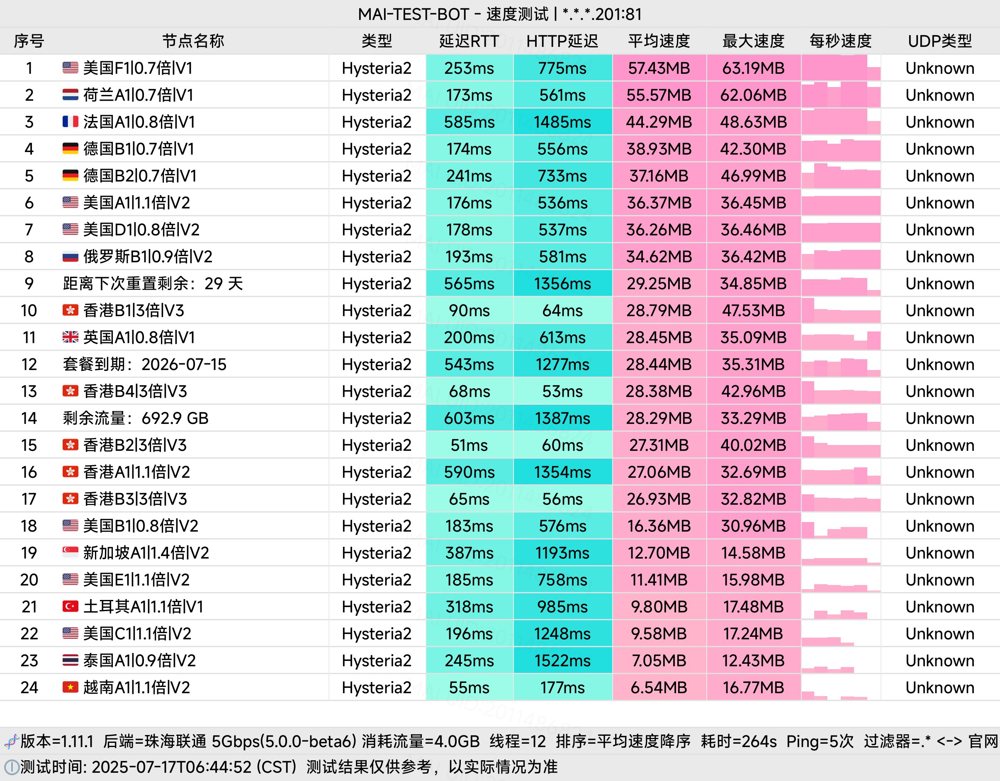
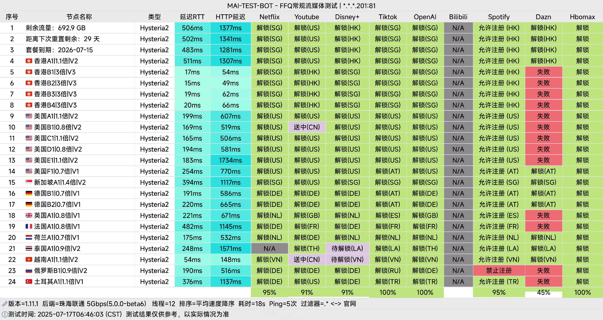

🇨🇳 [中文](README.md) | 🇺🇸 English | 🇷🇺 [Русский](README_RU.md) | 🇮🇷 [فارسی](README_FA.md)

# CrossWall VPN Official Website (Updated November 4, 2026)

CrossWall VPN Official Website<br>
Latest Address 01: [www.cross666.top](https://to.iix.im/cro03)<br>
Latest Address 02: [www.crosswall.org](https://to.iix.im/cro02)<br>
Official Website: [keluosi.top](https://to.iix.im/cro01)<br>

2026 Best VPN Recommendations and Proxy Node Sharing: [https://github.com/jdnei/JiChangTuiJian](https://github.com/jdnei/JiChangTuiJian)<br>

## Telegram VPN Community #AD

[VPN Giveaway Group](https://331024.de/archives/choujiang) | [VPN Chat Group](https://331024.de/archives/choujiang) | [VPN Trial Group](https://331024.de/archives/choujiang)<br>

[https://331024.de/archives/choujiang](https://331024.de/archives/choujiang)

## Invitation Code

```bash
fpQ5Bw17
```

## Coupon Code / Discount Code

`20% OFF. Expires October 8.`

```bash
MOON80
```

## Introduction

CrossWall VPN is an affordable network acceleration service provider that uses high-quality transit and direct connection routes.

It supports mainstream proxy protocols and aims to provide users with stable, fast, and reliable international internet connectivity.

## Advantages

**Extensive Node Coverage:** CrossWall offers a wide selection of server locations and network routes, providing flexible access to international internet services.

**Privacy and Security:** The service uses advanced encryption technologies to help protect user data and privacy.

**High Bandwidth and Low Latency:** Its network infrastructure is designed to support 4K video streaming and low-latency international online gaming.

**Cross-Platform Compatibility:** CrossWall supports popular proxy clients across multiple platforms and allows several devices to connect simultaneously.

**Flexible and Affordable Plans:** Multiple subscription tiers accommodate different traffic requirements and budgets.

**24/7 Technical Support:** Round-the-clock customer assistance is available to help users resolve connection issues.

## Subscription Plans

| Plan | Price | Billing Cycle | Monthly Traffic (Base) | Monthly Traffic (Maximum with Reduced Multiplier) | Network Tier |
|---|---:|---|---|---|---|
| **Medium** | ¥13.9 | Monthly | 396 GB | 565 GB | V2 (includes V1) |
| **Large** | ¥21.9 | Monthly | 693 GB | 990 GB | V2 (includes V1) |
| **Extra Large** | ¥39.9 | Monthly | 1389 GB | 1985 GB | V2 (includes V1) |
| **Ultimate** | ¥65.6 | Monthly | 2492 GB | 3560 GB | V2 (includes V1) |
| **Trial** | ¥25.0 | Quarterly | 200 GB | 285 GB | V2 (includes V1) |
| **Value** | ¥132.0 | Annually | 840 GB | 1200 GB | V1 |
| **Value – 84** | ¥84.0 | Annually | 445 GB | 636 GB | V1 |
| **Value – 48** | ¥48.0 | Annually | 200 GB | 285 GB | V1 |
| **Pay-As-You-Go – 500** | ¥75.0 | One-time | 500 GB *(no expiration)* | 714 GB *(no expiration)* | V2 (includes V1) |

## 📊 Performance Tests and Analysis

#### 1. Evening Peak-Hour Speed Test



#### 2. Streaming Platform Unblocking Report



#### 3. Entry and Exit Node Analysis


