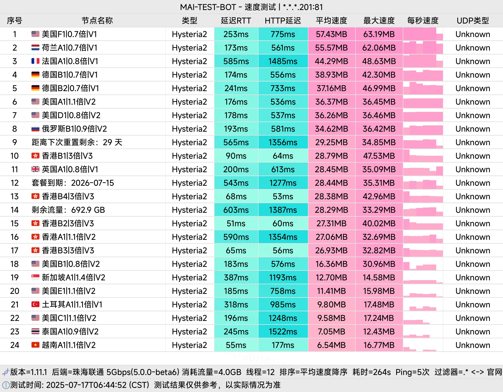
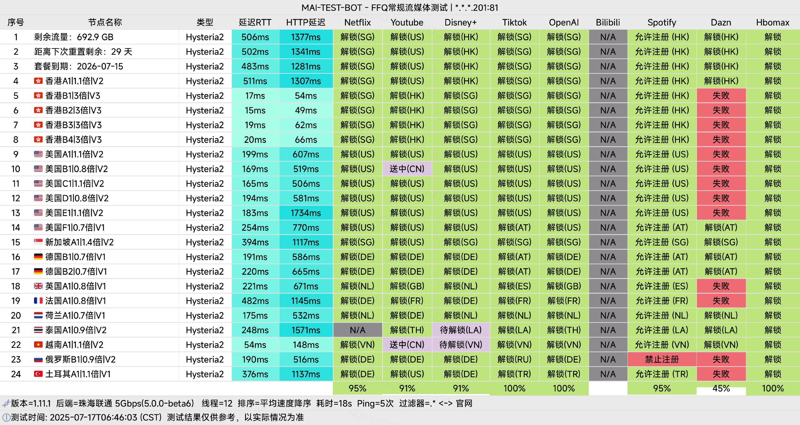

 🇨🇳 [中文](README.md) | 🇺🇸 [English](README_EN.md) | 🇷🇺 [Русский](README_RU.md) | 🇮🇷 فارسی

# وب‌سایت رسمی فیلترشکن CrossWall (به‌روزرسانی: ۳ نوامبر ۲۰۲۶)

وب‌سایت رسمی فیلترشکن CrossWall<br>
جدیدترین آدرس ۰۱: [www.cross666.top](https://to.iix.im/cro03)<br>
جدیدترین آدرس ۰۲: [www.crosswall.org](https://to.iix.im/cro02)<br>
آدرس رسمی: [keluosi.top](https://to.iix.im/cro01)<br>

معرفی بهترین سرویس‌های VPN و اشتراک‌گذاری سرورهای پروکسی در سال ۲۰۲۶: [https://github.com/jdnei/JiChangTuiJian](https://github.com/jdnei/JiChangTuiJian)<br>

## انجمن تلگرامی VPN #AD

[گروه قرعه‌کشی VPN](https://331024.de/archives/choujiang) | [گروه گفت‌وگوی VPN](https://331024.de/archives/choujiang) | [گروه تست VPN](https://331024.de/archives/choujiang)<br>

[https://331024.de/archives/choujiang](https://331024.de/archives/choujiang)

## کد دعوت

```bash
fpQ5Bw17
```

## کد تخفیف

`۲۰٪ تخفیف؛ پایان اعتبار: ۸ اکتبر`

```bash
MOON80
```

## معرفی

CrossWall یک سرویس VPN و شتاب‌دهنده شبکه با قیمت مناسب است که از مسیرهای انتقال باکیفیت و اتصالات مستقیم استفاده می‌کند.

این سرویس از پروتکل‌های رایج پروکسی پشتیبانی می‌کند و هدف آن ارائه اتصال پایدار، سریع و قابل‌اعتماد به اینترنت بین‌المللی است.

## مزایا

**پوشش گسترده سرورها:** CrossWall سرورهایی در مناطق جغرافیایی مختلف و مسیرهای ارتباطی متنوع ارائه می‌دهد که دسترسی انعطاف‌پذیر به خدمات اینترنتی بین‌المللی را ممکن می‌سازد.

**حریم خصوصی و امنیت:** این سرویس از فناوری‌های رمزنگاری پیشرفته برای کمک به محافظت از اطلاعات و حریم خصوصی کاربران استفاده می‌کند.

**پهنای باند بالا و تأخیر پایین:** زیرساخت شبکه برای پشتیبانی از تماشای ویدئوهای 4K و بازی‌های آنلاین بین‌المللی با تأخیر کم طراحی شده است.

**سازگاری با پلتفرم‌های مختلف:** CrossWall با کلاینت‌های رایج پروکسی در سیستم‌عامل‌های مختلف سازگار است و امکان اتصال هم‌زمان چندین دستگاه را فراهم می‌کند.

**طرح‌های انعطاف‌پذیر و مقرون‌به‌صرفه:** طرح‌های اشتراک متنوع برای پاسخ‌گویی به نیازهای مختلف ترافیک و بودجه ارائه می‌شوند.

**پشتیبانی فنی شبانه‌روزی:** خدمات پشتیبانی مشتریان به‌صورت ۲۴ ساعته برای کمک به رفع مشکلات اتصال ارائه می‌شود.

## طرح‌های اشتراک

| طرح | قیمت | دوره پرداخت | ترافیک ماهانه (پایه) | حداکثر ترافیک ماهانه با ضریب مصرف کمتر | سطح شبکه |
|---|---:|---|---|---|---|
| **متوسط (Medium)** | ¥13.9 | ماهانه | 396 گیگابایت | 565 گیگابایت | V2 (شامل V1) |
| **بزرگ (Large)** | ¥21.9 | ماهانه | 693 گیگابایت | 990 گیگابایت | V2 (شامل V1) |
| **خیلی بزرگ (Extra Large)** | ¥39.9 | ماهانه | 1389 گیگابایت | 1985 گیگابایت | V2 (شامل V1) |
| **ویژه (Ultimate)** | ¥65.6 | ماهانه | 2492 گیگابایت | 3560 گیگابایت | V2 (شامل V1) |
| **آزمایشی (Trial)** | ¥25.0 | سه‌ماهه | 200 گیگابایت | 285 گیگابایت | V2 (شامل V1) |
| **اقتصادی (Value)** | ¥132.0 | سالانه | 840 گیگابایت | 1200 گیگابایت | V1 |
| **اقتصادی – 84** | ¥84.0 | سالانه | 445 گیگابایت | 636 گیگابایت | V1 |
| **اقتصادی – 48** | ¥48.0 | سالانه | 200 گیگابایت | 285 گیگابایت | V1 |
| **پرداخت بر اساس مصرف – 500** | ¥75.0 | یک‌بار پرداخت | 500 گیگابایت *(بدون محدودیت زمانی)* | 714 گیگابایت *(بدون محدودیت زمانی)* | V2 (شامل V1) |

## 📊 آزمایش عملکرد و تحلیل

#### ۱. آزمایش سرعت در ساعات اوج مصرف شبانه



#### ۲. گزارش رفع محدودیت سرویس‌های پخش آنلاین



#### ۳. تحلیل سرورهای ورودی و خروجی


