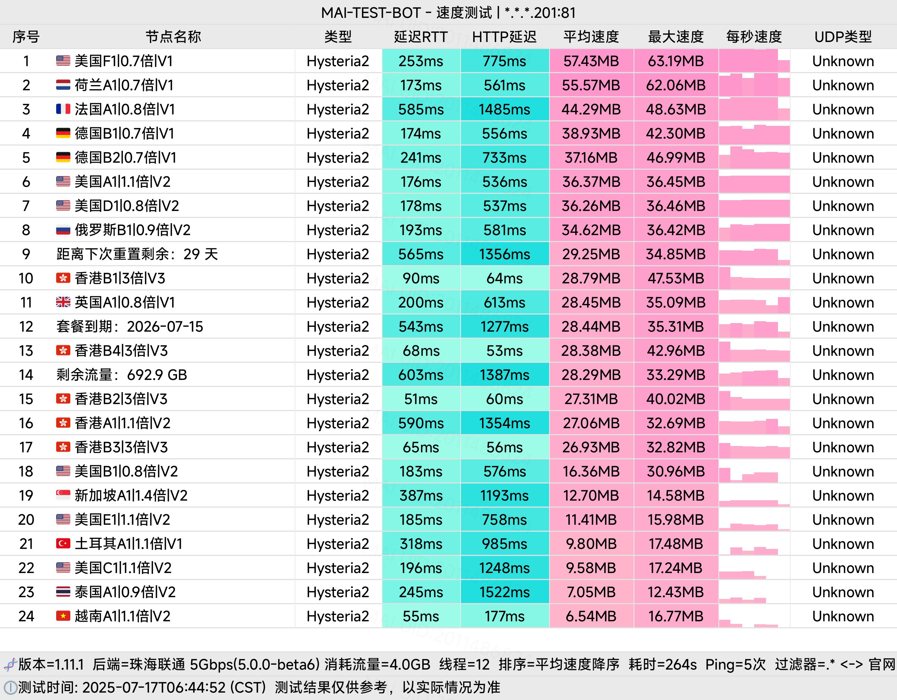
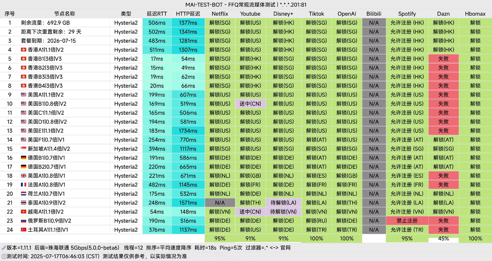

🇨🇳 [中文](README.md) | 🇺🇸 [English](README_EN.md) | 🇷🇺 Русский | 🇮🇷 [فارسی](README_FA.md)

# Официальный сайт CrossWall VPN (обновлено 6 ноября 2026)

Официальный сайт CrossWall VPN<br>
Новый адрес 01: [www.cross666.top](https://to.iix.im/cro03)<br>
Новый адрес 02: [www.crosswall.org](https://to.iix.im/cro02)<br>
Официальный адрес: [keluosi.top](https://to.iix.im/cro01)<br>

Лучшие VPN-сервисы и прокси-серверы 2026 года: [https://github.com/jdnei/JiChangTuiJian](https://github.com/jdnei/JiChangTuiJian)<br>

## Telegram-сообщество VPN #AD

[Группа розыгрышей VPN](https://331024.de/archives/choujiang) | [Чат VPN](https://331024.de/archives/choujiang) | [Группа тестирования VPN](https://331024.de/archives/choujiang)<br>

[https://331024.de/archives/choujiang](https://331024.de/archives/choujiang)

## Пригласительный код

```bash
fpQ5Bw17
```

## Промокод / Код скидки

`Скидка 20%. Срок действия — до 8 октября.`

```bash
MOON80
```

## Описание

CrossWall — доступный VPN-сервис для ускорения интернет-соединения, использующий качественные транзитные маршруты и прямые подключения.

Сервис поддерживает популярные прокси-протоколы и предназначен для обеспечения стабильного, быстрого и надёжного доступа к зарубежным интернет-ресурсам.

## Преимущества

**Широкое покрытие серверов:** CrossWall предлагает разнообразные серверы и сетевые маршруты в различных регионах, обеспечивая гибкий доступ к международным интернет-сервисам.

**Конфиденциальность и безопасность:** Используются современные технологии шифрования, предназначенные для защиты пользовательских данных и личной информации.

**Высокая пропускная способность и низкая задержка:** Сетевая инфраструктура рассчитана на просмотр потокового видео в формате 4K и международные онлайн-игры с минимальной задержкой.

**Совместимость с различными платформами:** CrossWall поддерживает популярные прокси-клиенты на разных устройствах и позволяет подключать несколько устройств одновременно.

**Гибкие и доступные тарифы:** Несколько вариантов подписки позволяют выбрать подходящий объём трафика в соответствии с потребностями и бюджетом.

**Круглосуточная техническая поддержка:** Служба поддержки работает 24 часа в сутки и помогает пользователям решать проблемы с подключением.

## Тарифные планы

| Тариф | Цена | Период оплаты | Месячный трафик (базовый) | Максимальный месячный трафик при пониженном коэффициенте | Уровень сети |
|---|---:|---|---|---|---|
| **Средний (Medium)** | ¥13.9 | Ежемесячно | 396 ГБ | 565 ГБ | V2 (включает V1) |
| **Большой (Large)** | ¥21.9 | Ежемесячно | 693 ГБ | 990 ГБ | V2 (включает V1) |
| **Очень большой (Extra Large)** | ¥39.9 | Ежемесячно | 1389 ГБ | 1985 ГБ | V2 (включает V1) |
| **Максимальный (Ultimate)** | ¥65.6 | Ежемесячно | 2492 ГБ | 3560 ГБ | V2 (включает V1) |
| **Пробный (Trial)** | ¥25.0 | Ежеквартально | 200 ГБ | 285 ГБ | V2 (включает V1) |
| **Выгодный (Value)** | ¥132.0 | Ежегодно | 840 ГБ | 1200 ГБ | V1 |
| **Выгодный – 84** | ¥84.0 | Ежегодно | 445 ГБ | 636 ГБ | V1 |
| **Выгодный – 48** | ¥48.0 | Ежегодно | 200 ГБ | 285 ГБ | V1 |
| **Оплата по объёму трафика – 500** | ¥75.0 | Единовременно | 500 ГБ *(без ограничения срока)* | 714 ГБ *(без ограничения срока)* | V2 (включает V1) |

## 📊 Тестирование производительности и анализ

#### 1. Тест скорости в вечерние часы пик



#### 2. Отчёт о разблокировке стриминговых сервисов



#### 3. Анализ входных и выходных узлов


